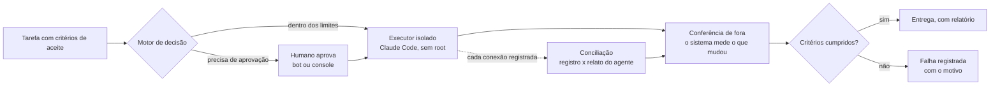

# Arquitetura do FOX Studio (visão geral)

Uma visão de alto nível. Os detalhes de infraestrutura ficam no repositório privado.

## O fluxo de uma tarefa

## As peças

- **Grafo de tarefas:** o trabalho é dividido em tarefas com dependências, critérios de aceite e dono. Nenhuma tarefa "acaba" sem os critérios conferidos.
- **Motor de decisão:** escolhe o que pode rodar agora, dentro dos limites de custo, de tempo e de permissão.
- **Executor isolado:** o agente (Claude Code) roda num container próprio, sem root, enxergando só a pasta da execução e com a saída de rede restrita ao que a tarefa precisa. Cada conexão que sai fica registrada, e o registro é conciliado com o que o agente relatou.
- **Conferência:** depois da execução, o sistema mede o que mudou com um repositório e um ambiente próprios, sem ler nada que o agente possa ter preparado. A conferência roda antes de qualquer código do trabalho.
- **Governança:** papéis separados no banco (quem planeja, quem executa, quem aprova) e aprovações humanas por um bot e por um console.
- **Backup:** cópia diária cifrada para duas chaves (uma de teste na máquina, outra de desastre guardada fora dela), restaurada e conferida toda noite, enviada para um armazenamento externo com trava contra exclusão, e um alarme quando o último backup bom fica velho demais.

## Os princípios

1. **Medir antes de consertar.** Toda hipótese de falha é reproduzida primeiro.
2. **Prova com controle invertido.** Todo teste de segurança é rodado também sem o conserto, e tem de falhar.
3. **"Não sei" não é "está certo".** Quando o sistema não consegue ver, ele diz que não conseguiu, e não que deu tudo certo.
4. **Lista permitida, e não lista proibida.** O que pode é nomeado; o resto é recusado.
5. **O humano no que é irreversível.** Apagar, publicar, liberar acesso e mexer em dinheiro passam por uma pessoa.
